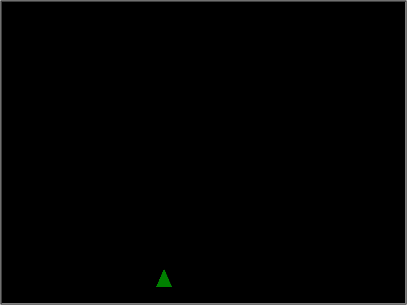
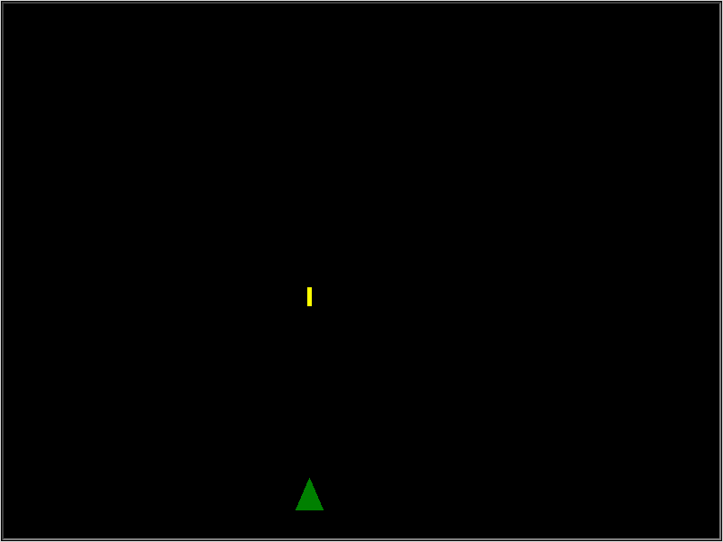
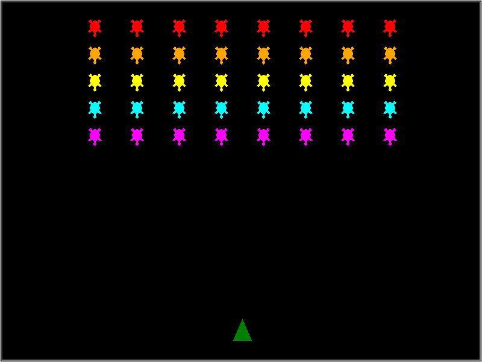
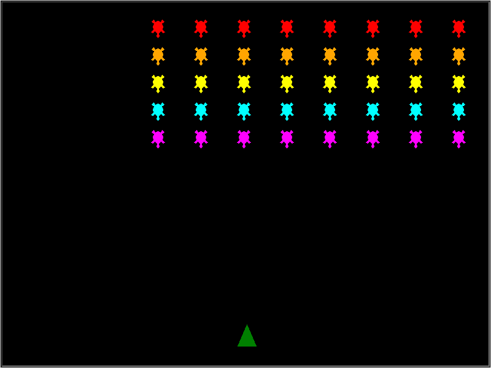
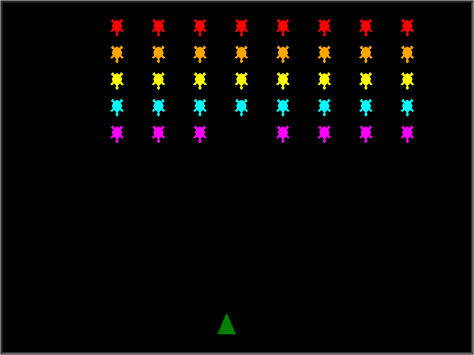
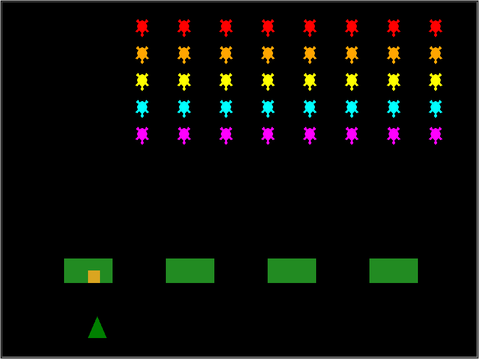
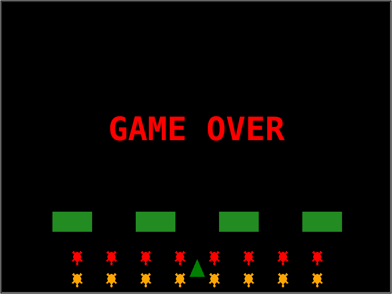
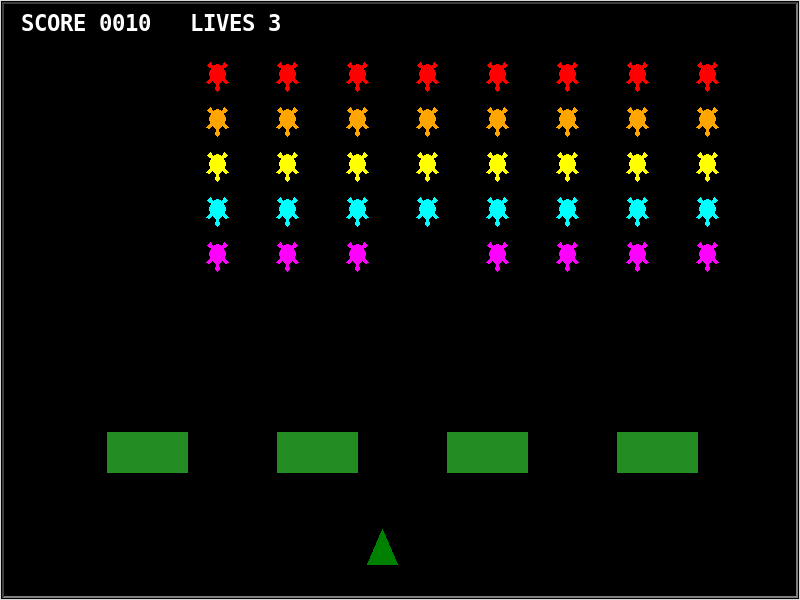

# 🚀 Space Invaders

The classic Space Invaders shoot 'em up for one player, built with Python's
`turtle` module as the Day 95 assignment of Udemy's *100 Days of Code: The
Complete Python Pro Bootcamp*. You steer a spaceship left and right and shoot
the alien ships; every second the aliens move closer, and when they touch your
ship the game is over. Barriers offer defensive positions. It has no runtime
dependencies.

## 📚 Table of Contents

- [Overview](#-overview)
- [Requirements](#-requirements)
- [Setup](#-setup)
- [Run](#-run)
- [Tests](#-tests)
- [License](#-license)
- [Links](#-links)
- [Appendix: Project documents](#-appendix-project-documents)

## 🧭 Overview

The game is built in nine steps, one branch and one pull request per step. The
guides, with a screenshot of every step and what each step taught, are in the
[project wiki][documentation], in English, Dansk and Bahasa Melayu.

### Build steps

Each step is one branch and one pull request. The wiki explains what each step taught.

**Step 1: Game screen.** A black window and a frame loop. ([wiki](https://git.tirsystem.com/Tirsvad-Udemy-100-days-of-code/095-assignment-space-invaders/wiki/Step-1-Game-Screen))


**Step 2: Spaceship.** The ship moves left and right and stops at the edges. ([wiki](https://git.tirsystem.com/Tirsvad-Udemy-100-days-of-code/095-assignment-space-invaders/wiki/Step-2-Spaceship))



**Step 3: Shooting.** <kbd>Space</kbd> fires one bullet at a time. ([wiki](https://git.tirsystem.com/Tirsvad-Udemy-100-days-of-code/095-assignment-space-invaders/wiki/Step-3-Shooting))



**Step 4: Alien fleet.** Five rows of eight aliens. ([wiki](https://git.tirsystem.com/Tirsvad-Udemy-100-days-of-code/095-assignment-space-invaders/wiki/Step-4-Alien-Fleet))



**Step 5: Alien movement.** Every second the fleet moves closer. ([wiki](https://git.tirsystem.com/Tirsvad-Udemy-100-days-of-code/095-assignment-space-invaders/wiki/Step-5-Alien-Movement))



**Step 6: Shooting aliens.** A bullet removes an alien; the fleet speeds up. ([wiki](https://git.tirsystem.com/Tirsvad-Udemy-100-days-of-code/095-assignment-space-invaders/wiki/Step-6-Shooting-Aliens))



**Step 7: Barriers.** Barriers absorb bullets and wear out. ([wiki](https://git.tirsystem.com/Tirsvad-Udemy-100-days-of-code/095-assignment-space-invaders/wiki/Step-7-Barriers))



**Step 8: Game over and win.** Aliens touch the ship: game over. No aliens left: you win. ([wiki](https://git.tirsystem.com/Tirsvad-Udemy-100-days-of-code/095-assignment-space-invaders/wiki/Step-8-Game-Over-and-Win))



**Step 9: Score and lives.** Score, lives and the aliens' return fire. ([wiki](https://git.tirsystem.com/Tirsvad-Udemy-100-days-of-code/095-assignment-space-invaders/wiki/Step-9-Score-and-Lives))



### Project layout

| Path | Contents |
| --- | --- |
| `.editorconfig` | Editor settings of the framework baseline |
| `.env.example` | Placeholders for the tokens of the framework scripts |
| `src/` | Game source; every constant is in `constants.py` |
| `tests/` | pytest tests |
| `tools/` | Docker image and script that take the screenshots on a virtual display |
| `docs/` | Project documents, `docs/wiki/` (the wiki) and `docs/images/` (screenshots) |
| `framework/` | SQA and QC framework (git submodule) |
| `pyproject.toml` | Project configuration |
| `Doxyfile` | Doxygen configuration |

## 📋 Requirements

- Python 3.14 or newer, with Tk support (`turtle` needs it)
- `git`
- Doxygen (optional, only to build the source documentation)
- Docker (optional, only to take the screenshots)

## 🛠️ Setup

Clone the repository, then create and use a local `.venv` and update `pip` inside it.

```bash
git clone ssh://git@git.tirsystem.com:10022/Tirsvad-Udemy-100-days-of-code/095-assignment-space-invaders.git
cd 095-assignment-space-invaders
```

### Windows PowerShell

```powershell
py -3.14 -m venv .venv
.\.venv\Scripts\Activate.ps1
python -m pip install --upgrade pip
python -m pip install -e ".[dev]"
```

### Linux and macOS

```bash
python3.14 -m venv .venv
source .venv/bin/activate
python -m pip install --upgrade pip
python -m pip install -e ".[dev]"
```

On Debian and Ubuntu, `turtle` needs the Tk library: `sudo apt install python3-tk`.
Leave the environment with `deactivate`. The game itself needs no installed
package, only the standard library; the `dev` extra adds `pytest`.

## ▶️ Run

With the `.venv` active:

```bash
python src/main.py
```

Controls: **Left** and **Right** arrow keys move the ship, **Space** fires.

## 🧪 Tests

With the `.venv` active:

```bash
python -m pytest
```

Tests that open a `turtle` window are skipped on your machine, so a test run never takes over your desktop. They run in the Docker container on a virtual display:

```bash
docker build -t space-invaders-shots tools
docker run --rm -v "$PWD:/work" -e SPACE_INVADERS_GUI_TESTS=1 -e PYTHONPATH=src --entrypoint bash space-invaders-shots -c "timeout 120 xvfb-run -a python -m pytest"
```

Optional checks:

```bash
doxygen Doxyfile
```

Before every push, scan the working tree with the local opengrep binary and
fix every finding. On Windows (PowerShell):

```powershell
& "$HOME\.opengrep\cli\latest\opengrep.exe" scan --config auto --error .
```

### Screenshots

The screenshots are taken inside a Docker container on a virtual display, so the
game never opens on your desktop:

```bash
docker build -t space-invaders-shots tools
docker run --rm -v "$PWD:/work" space-invaders-shots step-01-screen 3
```

The arguments are the file name (written to `docs/images/`), the seconds to wait
and, optionally, key names to press, for example `Left Left space`. Set `-e SCENARIO=tools/scenarios/game_over.py` to run a prepared situation (for example a lost game) instead of `src/main.py`.

## 📄 License

GNU Affero General Public License v3.0 or later; see [LICENSE](LICENSE).

## 🔗 Links

- [Repository][repository]
- [Documentation][documentation]
- [Issue tracker][issues]

## 📎 Appendix: Project documents

The documents a newcomer needs, in reading order.

| Document | What it tells you |
| --- | --- |
| [AGENTS.md][agents] | The rules agents follow in this repository |
| [Business Case][BC-001] | Why the project exists, its scope and success criteria |
| [Stakeholder Analysis][SA-001] | Who is involved; the stakeholder IDs used for owners and reviewers |
| [Project Plan][PP-001] | The gateways and their schedule |
| [Milestones][milestones] | One document per gateway: Go/No-Go criteria and tasks |
| [Artifact registry][registry] | Where each artifact type lives, the next version, the PO language and domain |
| [Framework README][framework-readme] | The framework this project uses |
| [Framework changelog][framework-changelog] | What changed in each framework release |

---

[repository]: https://git.tirsystem.com/Tirsvad-Udemy-100-days-of-code/095-assignment-space-invaders
[documentation]: https://git.tirsystem.com/Tirsvad-Udemy-100-days-of-code/095-assignment-space-invaders/wiki
[issues]: https://git.tirsystem.com/Tirsvad-Udemy-100-days-of-code/095-assignment-space-invaders/issues
[agents]: ./AGENTS.md
[BC-001]: ./docs/business-case.md
[SA-001]: ./docs/stakeholder-analysis.md
[PP-001]: ./docs/project-plan.md
[milestones]: ./docs/milestones/
[registry]: ./docs/artifact-registry.md
[framework-readme]: ./framework/README.md
[framework-changelog]: ./framework/CHANGELOG.md
