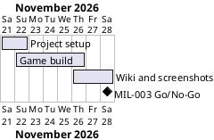

# Project Plan

## Metadata
| Key | Value |
| --- | --- |
| ID | PP-001 |
| CrossReference | [BC-001], [SA-001], [MIL-001], [MIL-002], [MIL-003] |
| Language | en |
| Domain | it |

## Version History
| Date | Status | Author | Reviewer | Change | Commit |
| --- | --- | --- | --- | --- | --- |
| 2026-11-21 | Deprecated | Jens Tirsvad Nielsen | Stand-in for S01 | Accepted with a Go (RC-003); reviewed in autonomous mode, not independent | [587a239] |
| 2026-11-21 | Accepted | Jens Tirsvad Nielsen | Stand-in for S01 | Linked the three milestones of the git host in the schedule and updated the open issues; reviewed in autonomous mode, not independent (RC-018) | [0449c45] |

---

## Purpose

Schedules the three gateways of the Space Invaders project within one week, with one branch and one pull request per task so the steps stay traceable.

## Planning Assumptions

- The plan starts 2026-11-21 and ends by 2026-11-28; the Business Case sets no external deadline.
- Phase length: one to four days; one pull request per task.
- S01 owns, builds and reviews; review is by S01 or, in autonomous mode, by a stand-in for S01, and the review record says so.
- Screenshots are taken in a Docker container, never on the host desktop.

## Gateway Schedule

| Gateway | Document | Window | Decision date | Owner | Stories | Main deliverable | Milestone |
| --- | --- | --- | --- | --- | --- | --- | --- |
| Project setup | [MIL-001] | 2026-11-21 to 2026-11-22 | 2026-11-22 | S01 | none | Scaffold, README, screenshot harness, repository description and topics | [milestone-698](https://git.tirsystem.com/Tirsvad-Udemy-100-days-of-code/095-assignment-space-invaders/milestone/698) |
| Game build | [MIL-002] | 2026-11-22 to 2026-11-26 | 2026-11-26 | S01 | none | Playable, tested game built in nine steps | [milestone-699](https://git.tirsystem.com/Tirsvad-Udemy-100-days-of-code/095-assignment-space-invaders/milestone/699) |
| Wiki and screenshots | [MIL-003] | 2026-11-26 to 2026-11-28 | 2026-11-28 | S01 | none | README screenshots and wiki in three languages | [milestone-700](https://git.tirsystem.com/Tirsvad-Udemy-100-days-of-code/095-assignment-space-invaders/milestone/700) |



## Scope Coverage

| Business Case scope item | Gateway |
| --- | --- |
| `pyproject.toml`, `.gitignore`, `constants.py`, Doxyfile, README, tests set-up | MIL-001 |
| Repository description and topics, local scan | MIL-001 |
| Game, barriers, game over, score and lives, tests, Doxygen comments | MIL-002 |
| Screenshot per build step | MIL-002 (taken) and MIL-003 (published) |
| Wiki in three languages and reflection journal | MIL-003 |

## Dependencies

```
MIL-001 → MIL-002 → MIL-003
```

Each gateway needs the one before it. A No-Go returns the gateway to S01 and moves the later dates; S01 decides the new date.

```
```

## Plan Risks

| Risk | Impact | Mitigation |
| --- | --- | --- |
| Tk in the Docker image or the virtual display fails | No screenshots | Build the harness first (MIL-001 task 4); stop and report if no isolated environment works |
| Translations lag the English text | Gateway date slips | English is authoritative; translate page by page after it is stable |

## Open Issues

- No use case or user story is modelled: the tasks are technical or documentation tasks, so the Stories column says `none`.
- The git host published the three milestones after the first merge (milestones 698 to 700); MIL-001 and MIL-002 are finished and their issues are closed, and the milestones are closed when MIL-003 is merged.

---

[BC-001]: ./business-case.md
[MIL-001]: ./milestones/mil-001-project-setup.md
[MIL-002]: ./milestones/mil-002-game-build.md
[MIL-003]: ./milestones/mil-003-wiki-and-screenshots.md
[SA-001]: ./stakeholder-analysis.md
[587a239]: https://git.tirsystem.com/Tirsvad-Udemy-100-days-of-code/095-assignment-space-invaders/commit/587a2399dcf6574753ed41a81dc5fec6f6f3e9c0
[0449c45]: https://git.tirsystem.com/Tirsvad-Udemy-100-days-of-code/095-assignment-space-invaders/commit/0449c455073ca4c58225d1673c46ee6fcf4d7ade
